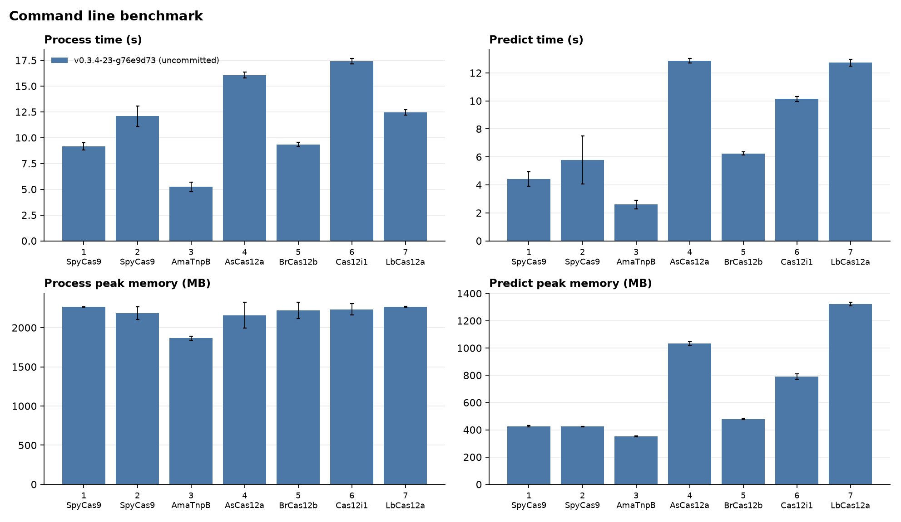
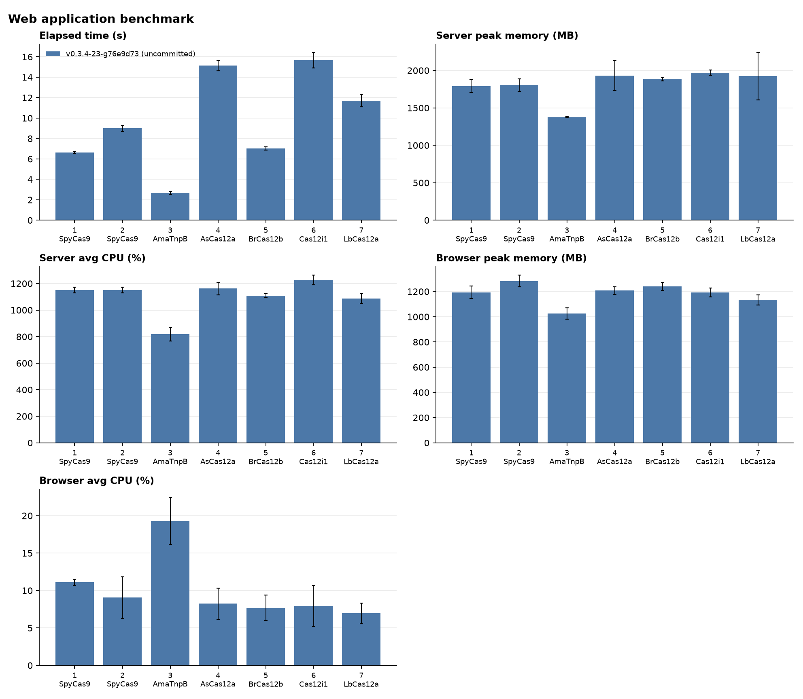

# Benchmarking performance of TamiPami

Nothing here hard codes a version. Each benchmark target is a git *ref*: by default the most recent
release tag and the current working tree. Result files are named from `git describe`
(for example `results/cli_v0.3.4.csv`) and each has a `.meta.json` sidecar recording the commit, tags,
whether the working tree was dirty, the hardware, and Chrome/BBMap/Python versions. Tagged refs are
checked out into a temporary `git worktree` and imported through `PYTHONPATH`, so nothing is installed
and your checkout is untouched.

Run everything with the conda environment from `conda-requirements.txt` (it provides `bbmerge.sh`) plus
`psutil`, `pandas`, `matplotlib` and, for the web app benchmark, `selenium` and Chrome.
For publishable numbers, commit first: working-tree results are labeled `-dirty` and are only
reproducible if the exact diff is kept.

## Command line benchmarking

```bash
python run_benchmark.py --num_runs 10                      # latest tag + working tree
python run_benchmark.py --ref v0.3.4 --ref v0.3.3 -n 10    # any tags, branches or commits
```

Runs `process` then `predict` for every row of `../data/metadata/experiments.csv` (FASTQ in `../data/fastq`)
and reports wall time, peak memory and average CPU of the whole process tree (including the `bbmerge.sh`
Java child). `predict` uses a fixed z-score cutoff of 2 for every k-mer length stored in the HDF5 file, so
the workload is identical across releases. CPU is total CPU time over wall time (100% = one core busy).

## Web application benchmarking

```bash
python benchmark_app_chrome.py --num-runs 10 [--headless]  # same --ref options
```

For each ref the script starts its own `tamipami serve` on a free port and drives the real UI with
[Selenium](https://www.selenium.dev/documentation/), recording elapsed time and the server-side and browser-side
memory and CPU. The app does not cache FASTQ processing, so every submission is a first run.

## Summaries and figures

```bash
python summarize_benchmarks.py
```

Rebuilds the tables and PNG figures in `results/` from whatever result files exist and rewrites the
block below. For publication-style ggplot2 figures (PNG and PDF) and styled HTML tables in `results/R/`, run
`Rscript summarize_benchmarks.R` (needs ggplot2, dplyr, tidyr, readr, patchwork, kableExtra, jsonlite, scales). Degenerate-sequence solver benchmarks are in `degenerate_solver/` and `degenerate_multi/`.

<!-- BEGIN AUTO -->
## Test system configuration

Retrieved automatically when the benchmarks ran.

| Attribute | Value |
|---|---|
| Model | MacBook Pro |
| Chip | Apple M5 Pro |
| Cores | 15 (5 Super and 10 Performance) |
| Memory | 24 GB |
| macOS | 26.7.3 |
| Browser | Google Chrome 157.0.8103.79 |
| Python | 3.13.18 |

## Results

Generated by `summarize_benchmarks.py`; a styled version is in `results/report.html`.

### CLI results

#### v0.3.4-23-g76e9d73 (uncommitted)

Commit `76e9d730c` with uncommitted changes, run 2026-11-17; mean ± SD.

| Experiment | Enzyme | Runs | Process time (s) | Predict time (s) | Process peak memory (MB) | Predict peak memory (MB) | Process avg CPU (%) | Predict avg CPU (%) | Control read pairs | Experimental read pairs |
|---|---|---|---|---|---|---|---|---|---|---|
| 1 | SpyCas9 | 5 | 9.1 ± 0.4 | 4.4 ± 0.5 | 2266 ± 4 | 426 ± 6 | 876.6 ± 24.7 | 128.2 ± 4.3 | 642,368 | 551,539 |
| 2 | SpyCas9 | 5 | 12.1 ± 1.0 | 5.8 ± 1.7 | 2185 ± 81 | 424 ± 3 | 944.3 ± 46.1 | 142.8 ± 30.0 | 910,598 | 827,259 |
| 3 | AmaTnpB | 5 | 5.2 ± 0.4 | 2.6 ± 0.3 | 1865 ± 26 | 353 ± 3 | 466.8 ± 27.3 | 78.7 ± 6.5 | 171,537 | 130,279 |
| 4 | AsCas12a | 5 | 16.1 ± 0.3 | 12.9 ± 0.2 | 2158 ± 165 | 1033 ± 12 | 1062.9 ± 21.6 | 327.3 ± 1.1 | 642,982 | 2,247,820 |
| 5 | BrCas12b | 5 | 9.4 ± 0.2 | 6.2 ± 0.1 | 2221 ± 106 | 478 ± 2 | 895.1 ± 9.3 | 193.8 ± 1.7 | 642,982 | 686,819 |
| 6 | Cas12i1 | 5 | 17.4 ± 0.3 | 10.1 ± 0.2 | 2235 ± 71 | 790 ± 20 | 1145.4 ± 10.9 | 265.8 ± 2.2 | 1,278,593 | 1,686,551 |
| 7 | LbCas12a | 5 | 12.5 ± 0.3 | 12.7 ± 0.2 | 2265 ± 6 | 1323 ± 13 | 1007.6 ± 19.1 | 314.7 ± 1.4 | 642,982 | 1,436,737 |



### Web application results

#### v0.3.4-23-g76e9d73 (uncommitted)

Commit `76e9d730c` with uncommitted changes, run 2026-11-17; mean ± SD.

| Experiment | Enzyme | Runs | Elapsed time (s) | Server peak memory (MB) | Server avg CPU (%) | Browser peak memory (MB) | Browser avg CPU (%) | Control read pairs | Experimental read pairs |
|---|---|---|---|---|---|---|---|---|---|
| 1 | SpyCas9 | 5 | 6.6 ± 0.1 | 1790 ± 85 | 1151.6 ± 21.2 | 1194 ± 50 | 11.1 ± 0.4 | 642,368 | 551,539 |
| 2 | SpyCas9 | 5 | 9.0 ± 0.3 | 1806 ± 85 | 1150.7 ± 20.4 | 1283 ± 47 | 9.1 ± 2.8 | 910,598 | 827,259 |
| 3 | AmaTnpB | 5 | 2.7 ± 0.2 | 1375 ± 8 | 817.7 ± 50.2 | 1024 ± 45 | 19.3 ± 3.1 | 171,537 | 130,279 |
| 4 | AsCas12a | 5 | 15.1 ± 0.5 | 1931 ± 198 | 1162.4 ± 47.7 | 1208 ± 31 | 8.3 ± 2.1 | 642,982 | 2,247,820 |
| 5 | BrCas12b | 5 | 7.0 ± 0.2 | 1885 ± 26 | 1108.2 ± 15.3 | 1240 ± 32 | 7.7 ± 1.7 | 642,982 | 686,819 |
| 6 | Cas12i1 | 5 | 15.7 ± 0.8 | 1971 ± 37 | 1227.5 ± 35.7 | 1192 ± 35 | 8.0 ± 2.8 | 1,278,593 | 1,686,551 |
| 7 | LbCas12a | 5 | 11.7 ± 0.6 | 1923 ± 315 | 1086.3 ± 37.5 | 1133 ± 39 | 7.0 ± 1.4 | 642,982 | 1,436,737 |



<!-- END AUTO -->
