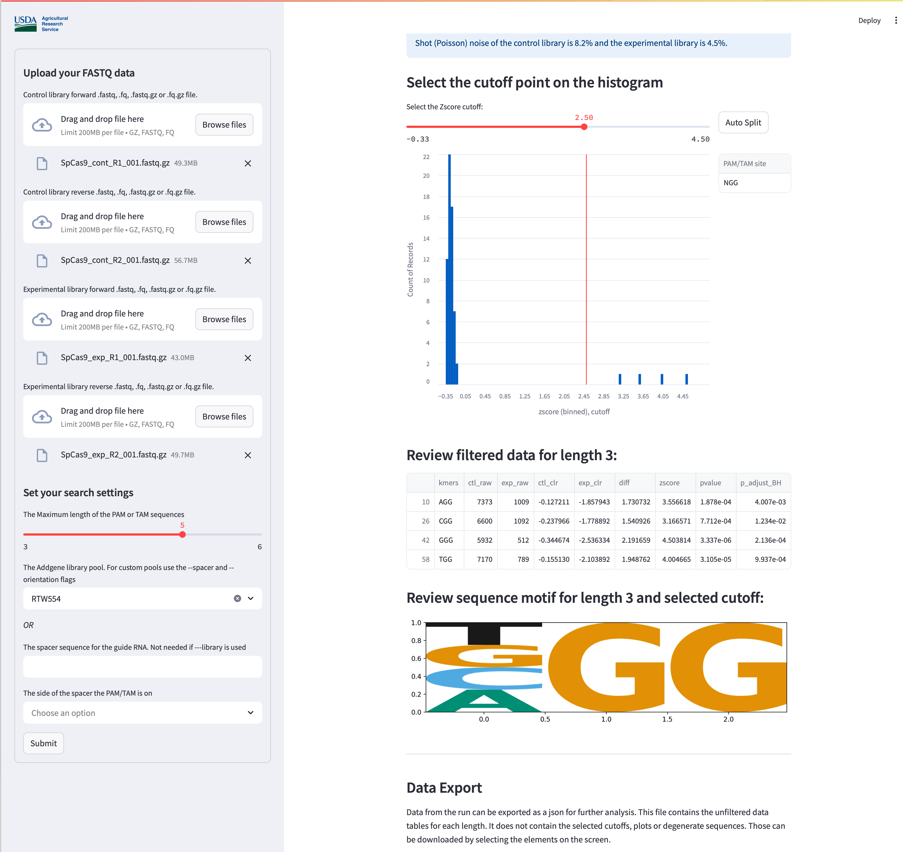

# Tamipami: A web application and command line interface for finding the TAM and PAM sites of novel endonucleases

[](https://doi.org/10.5281/zenodo.19055843)

__Carlos Orosco<sup>1</sup>, Piyush Jain<sup>1</sup>, Adam R. Rivers<sup>2</sup>__

1. University of Florida, Department of Chemical Engineering, Gainesville, FL, USA
2. United States Department of Agriculture, Agricultural Research Service, Genomics and Bioinformatics Research Unit, Gainesville, FL, USA


<br>

When a new Cas or TnpB guided endonuclease is discovered or engineered, one of the first tasks is identifying its PAM or TAM recognition site. This can be done by treating a pool of plasmid DNA containing a target site adjacent to a random region. The random regions containing the PAM/TAM site are recognized and cut in the presence of the endonuclease and a guide RNA. These become depleted in the sequencing library. By comparing an uncut control library to a cut experimental library it is possible to identify the PAM/TAM site.  The method was introduced by [Walton et al. 2021](https://doi.org/10.1038/s41596-020-00465-2).
That work deposited the plasmid pools with [Addgene](https://www.addgene.org/pooled-library/kleinstiver-ht-pamda/), making the lab protocol accessible.   

This web application and command line application builds on the work by creating software that simplifies the analysis of the sequencing data and adds rich interactive visualizations for selecting the PAM/TAM site.

## Run with Docker (easiest)

To run the web application from Docker run this command:

```{Bash}
docker run -d -p 8501:8501 ghcr.io/usda-ars-gbru/tamipami:latest
```

Then open http://localhost:8501 in your browser.

To use the Tamipami CLI interactively:

```{Bash}
docker run -it --rm -v $(pwd):/workspace -w /workspace --entrypoint /bin/bash ghcr.io/usda-ars-gbru/tamipami:latest
```

This mounts your current working directory at `/workspace` and opens a bash shell, ignoring the default entrypoint (which starts the web server). Your FASTQ files are then available in the current directory and results written there are saved on your computer.

##  Installation

The application can be installed into a conda environment using Pip and conda.


```{bash}
conda create -n tamipamienv -c conda-forge -c bioconda python=3.13
conda activate tamipamienv
git clone https://github.com/USDA-ARS-GBRU/tamipami.git # or git@github.com:USDA-ARS-GBRU/tamipami.git
cd tamipami
conda install  -c conda-forge -c bioconda --file conda-requirements.txt
pip install -r pip-requirements.txt
pip install .


# Verify  imports
python -c "import tamipami; import pyarrow; from ortools.sat.python import cp_model; print('Success: All libraries loaded correctly.')"

```


## Apple Silicon (M1 ,M2, M3, M4, M5)

Tamipami works fine on Mac. But, there are incompatibilities with some of the low-level C++ libraries used by OR-Tools and installed by conda or pip (primarily Abseil). You need to install conda dependencies in the specific order listed above using packages from conda and pip specified in their respective requirements files.

## Quick start with the example data

A small SpCas9 experiment (library RTW554) is included as `tamipami/assets/Example.zip` (it can also be downloaded from inside the web app).

```{bash}
unzip tamipami/assets/Example.zip -d example
tamipami process \
  --cont1 example/example_cont1.fastq.gz --cont2 example/example_cont2.fastq.gz \
  --exp1 example/example_exp1.fastq.gz --exp2 example/example_exp2.fastq.gz \
  --library RTW554 --outfile example.h5
tamipami predict --input example.h5 --predict_out example_out
```

`predict` writes one folder per length (`example_out/3`, `example_out/4`, `example_out/5`). For this SpCas9 data the 3-mer `degenerate_pam_tam.csv` contains `NGG` (and the 4-mer file `NGGN`), and the logo shows G at positions 2 and 3. Each run takes well under a minute. `process` and `predict` can also be piped together: `tamipami process ... | tamipami predict --predict_out example_out`.

## Choosing a library

`--library` (or the library menu in the web app) fills in the spacer and the PAM/TAM orientation of the Addgene pool you used. The pool must be the one your control and experimental plasmids were built from.

Library | Spacer (5′→3′) | Orientation | Used in the paper for
--------|----------------|-------------|----------------------
RTW554 | `GGGCACGGGCAGCTTGCCGG` | `3prime` (target, then PAM) | SpCas9
RTW555 | `GTCGCCCTCGAACTTCACCT` | `5prime` (PAM, then target) | not in the paper datasets
RTW572 | `GGAATCCCTTCTGCAGCACCTGG` | `3prime` (target, then PAM) | not in the paper datasets
RTW574 | `CTGATGGTCCATGTCTGTTACTC` | `5prime` (PAM/TAM, then target) | AsCas12a, LbCas12a, BrCas12b, Cas12i1, AmaTnpB

For a custom pool, give `--spacer` (A, C, G and T only) and `--orientation` instead of `--library`. `5prime` means the PAM/TAM is read immediately before the spacer, as for Cas12a and TnpB. `3prime` means it is read immediately after the spacer, as for SpCas9. See `tamipami/assets/3prime.jpg` and `5prime.jpg` for diagrams.

## Web Application

The web application can be found at [https://tamipami.che.ufl.edu](https://tamipami.che.ufl.edu)

To launch a the Tamipami web application locally at http://localhost:8501 run this command:

```{bash}
tamipami serve
```


Tamipami Inputs | Tamipami results
----------------|------------------
 | 

### Web application use

1. Load the forward and reverse FASTQ files for a single control and experimental library in the four input boxes on the sidebar.
2. Select the Addgene library used for the experiment. Or...
3. If no library is selected, enter the target sequence and the orientation (5prime is PAM-Target, 3prime is Target-PAM (like spCas9)).
4. Select the maximum PAM/TAM length to analyze (3 to 5). Lengths 3 up to the maximum are all computed, and you can compare them in separate tabs after processing.
5. Hit 'Submit'. This will process your files.
6. After you have hit 'Submit' you can explore your data interactively. The key interface is the z-score slider bar. Moving that will set the 
cutoff value to separate kmers that cut from those that did not. This will update the histogram of sequence z-scores, the table of reads the degenerate sequences created and the sequence motif.
By default at most the top 50% of k-mers can be selected; a lower cutoff is raised to that limit (uncheck "Limit selection to the top 50% of k-mers" to remove it). If the degenerate sequences are marked as not verified, they cover the selected k-mers exactly but the solver reached its time limit before proving that no smaller set exists.
7. Be sure to explore each length tab, to select the PAM/TAM site best supported by your data.
8. Export the raw run data.

## Command line program

To facilitate automated analysis we have also released a command line version of TamiPami.  The CLI has three subcommands: `process`,`predict` and `serve`. The subcommand `process` processes the raw FASTQ data into counts of k-mers. This data can be sent to an .h5 file or STDOUT. The second step, `predict`, predicts the degenerate PAM/TAM sequences for a cutoff value and produces summary plots. The commands can be piped together. The third subcommand, `serve`, launches the web application.

```
usage: tamipami [-h] [--log LOG] [-V] {serve,process,predict} ...

TamiPami: a CLI application to parse high throughput PAM/TAM site sequencing data

positional arguments:
  {serve,process,predict}
    serve               Subcommand "serve": launch the Tamipami web application.
    process             Sub-command "process": used to process FASTQ data into a summarized json output
    predict             Subcommand "predict" use to predict PAMs/TAMs and summary data for a selected length and cutoff value

options:
  -h, --help            show this help message and exit
  --log LOG             Log file
  -V, --version         show program's version number and exit
```

### Process

```
usage: tamipami process [-h] --cont1 CONT1 [--cont2 CONT2] --exp1 EXP1 [--exp2 EXP2] [--outfile OUTFILE] [--library {RTW554,RTW555,RTW572,RTW574}] [--spacer SPACER] [--orientation {3prime,5prime}]
                        [--length [3-5]]

options:
  -h, --help            show this help message and exit
  --cont1, -c CONT1     A forward .fastq, .fq, .fastq.gz or .fq.gz file. .
  --cont2, -c2 CONT2    Optional reverse .fastq, .fq, .fastq.gz or .fq.gz file for paired-end runs. Provide both --cont2 and --exp2, or omit both for single-end.
  --exp1, -e EXP1       A forward .fastq, .fq, .fastq.gz or .fq.gz file.
  --exp2, -e2 EXP2      Optional reverse .fastq, .fq, .fastq.gz or .fq.gz file for paired-end runs. Provide both --cont2 and --exp2, or omit both for single-end.
  --outfile OUTFILE     A path to a hdf5 file of the results, if missing binary data will be sent to STDOUT.
  --library {RTW554,RTW555,RTW572,RTW574}
                        The Addgene library pool. For custom pools use the --spacer and --orientation flags
  --spacer SPACER       The spacer sequence for the guide RNA. Not needed if ---library is used
  --orientation {3prime,5prime}
                        the side of the spacer the PAM/TAM is on
  --length [3-5]        The longest PAM or TAM length to count (default: 5). Results are
                        produced for every length from 3 up to this value.
```

### Predict

```
usage: tamipami predict [-h] [--input INPUT] [--cutoff CUTOFF] [--max_fraction MAX_FRACTION] --predict_out PREDICT_OUT

options:
  -h, --help            show this help message and exit
  --input INPUT         An file containing the data from a TamiPami process run or downloaded data from the web app, if no input is provided STDIN will be assumed
  --cutoff CUTOFF       Cutoff thresholds as a JSON dictionary with integer keys [3-5] and numeric values. Example: '{"3": 0.7, "4": 0.85, "5": 0.93}'. Keys must be integers between 3 and 5. Values
                        must be numbers. If omitted, a cutoff is computed automatically for each length.
  --max_fraction MAX_FRACTION
                        The largest fraction of k-mers, ranked by z-score, that can be selected as PAM/TAM sites. A cutoff that would select more is raised to this limit. Use 1 to disable. (default:
                        0.5)
  --predict_out PREDICT_OUT
                        A file directory containing the PAM/TAM and degenerate sequences identified
```

#### Choosing a cutoff

Cutoffs are z-scores: a k-mer is selected as a PAM/TAM when its depletion z-score is at least the cutoff, so a higher cutoff selects fewer k-mers. The values in the usage text above are only examples of the JSON format. If `--cutoff` is omitted, `predict` chooses a cutoff for each length automatically, and this is a good place to start. The web app's z-score slider is the easiest way to see how a cutoff changes the selection before you commit to one.

If you provide `--cutoff`, it must contain every length present in the input file: a run with the default `--length 5` contains lengths 3, 4 and 5, so give all three, for example `--cutoff '{"3": 1.5, "4": 2.0, "5": 2.5}'` (illustrative values; look at `histogram.html` from an automatic run to pick your own). By default at most the top 50% of k-mers can be selected, and a lower cutoff is raised to that limit (see `--max_fraction`).

#### Output files

For each length, `predict` writes `data.csv`, `histogram.html`, a sequence logo (`logo.pdf` by default) and `degenerate_pam_tam.csv`, in a subfolder named for the length. The degenerate file lists the IUPAC sequences covering the selected k-mers. Its `proven_optimal` column is `False` when the sequences cover the selection exactly but the solver reached its time limit before proving that no smaller set exists; raising the cutoff usually gives a proven result.

### Serve

```
usage: tamipami serve [-h] [--port PORT] [--host HOST]

options:
  -h, --help   show this help message and exit
  --port PORT  Port to run the Streamlit server on (default: 8501)
  --host HOST  Host address for the server (default: localhost)
```

## How the degenerate sequences are chosen

The selected k-mers (those with a z-score at or above the cutoff) are summarized as a set of IUPAC degenerate sequences, for example `NGG` or `TTYN`. The set is *exact*: every k-mer that a degenerate sequence expands to is in the selection, and every selected k-mer is matched by exactly one sequence. Among all exact sets, TamiPami returns the one with the fewest sequences, then the fewest degenerate positions, then the fewest allowed bases in total.

The search is done with the OR-Tools CP-SAT solver and a fixed (not wall-clock) time budget, so the same selection gives the same answer on any computer. When the solver proves that no better set exists, `proven_optimal` is `True` (the web app shows no note). When the time budget runs out first, you still get a valid exact cover, marked `proven_optimal = False` in `degenerate_pam_tam.csv` and flagged in the web app. A higher cutoff (fewer selected k-mers) normally gives a proven result. At the automatic cutoff the solver finishes in well under a second, and all tested selections of up to 25% of k-mers (up to 50% for k-mers of length 4 or less) were proven optimal. Validation against an independent solver, and timings, are in [`benchmark/degenerate_solver/README.md`](benchmark/degenerate_solver/README.md).

## Data availability

 Full datasets are available under NCBI Bioproject [PRJNA1298332](https://www.ncbi.nlm.nih.gov/bioproject/1298332). For more information on the samples see [`data/readme.md`](data/readme.md).

 Example data from one Cas9 experiment data can be downloaded from within the Tamipami web application. They are also available in this repository under `tamipami/assets/Example.zip`


## Performance

Detailed performance metrics for 7 datasets are found at [`benchmark/readme.md`](benchmark/readme.md). TL;DR on a 2023 laptop (Apple M2 Pro) the `process` step took about 6-18 seconds per dataset with v0.4.0 (8-29 seconds with v0.3.4), `predict` took 3-13 seconds and peak memory was about 300 MB. The web app tables in that file are from v0.3.4. Because the app does not cache FASTQ processing, every submission is a full run.

## Manuscript

TAMIPAMI: Software and methods for PAM/TAM identification in CRISPR and OMEGA gene editing systems. Carlos Orosco, Piyush K. Jain, Adam R. Rivers. 
bioRxiv 2026.05.15.725432; doi: https://doi.org/10.64898/2026.05.15.725432


## Version history

See [`CHANGELOG.md`](CHANGELOG.md). Version 0.4.0 changes the z-score statistics, the cutoff limit and the degenerate-sequence solver, so results can differ slightly from v0.3.4 and from the numbers in the bioRxiv preprint.

## Need more help?

If you need help or encounter errors please request support on the [Tamipami Github issues page](https://github.com/USDA-ARS-GBRU/tamipami/issues)   
    


## Google Analytics

The web app can optionally report usage through Google Analytics. Set the environment variable `GA_MEASUREMENT_ID` to a GA4 measurement ID (for example in a `.env` file next to `compose.yaml`). If it is not set, no analytics code is loaded.

## License information

This software is a work of the United States Department of Agriculture,
Agricultural Research Service (USDA-ARS) and is not copyrightable under U.S. Code Title 17, Section 105.
It is released under a Creative Commons CC0 public domain attribution.
